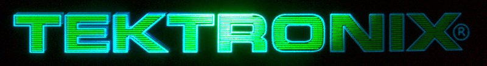
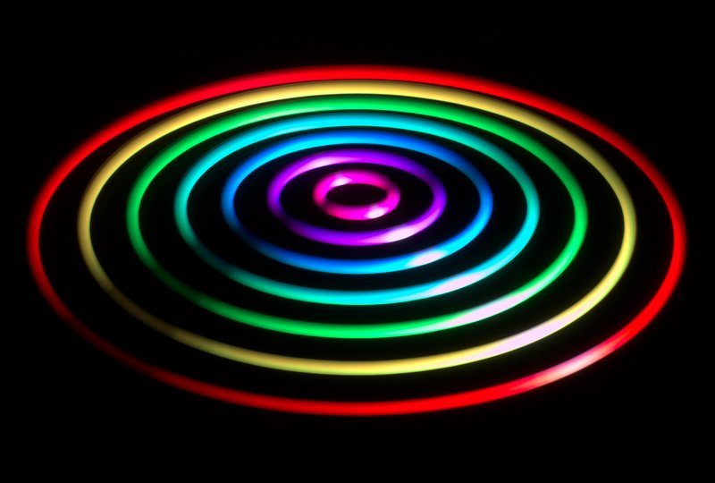

# Light Painting With a Tektronix 4662 Plotter

Many years ago I rescued an old Tektronix 4662 plotter from the
bin. The stepper motors and pen lifter worked, but some of the electronics were dead. I
bolted on some new electronics and mounted an LED on the pen carrier.

Pictures are made by "plotting" with the LED instead of a pen. With
the room dark, a digital camera holds its shutter open, looking down
on the plotter.

> **A note on Claude.** Almost all of the software for this project was written
> by [Claude Code](https://claude.com/claude-code), Anthropic's AI coding assistant, working under my direction.
> Claude also helped draft parts of this
> write-up. The hardware, the ideas and the choice of pictures are mine.
> More in [Working With Claude](docs/working_with_claude.md).

## Contents

1. **[The Plotter](docs/the_plotter.md)**: the rescued 4662, its new
   electronics, the wireless LED, and how everything talks to everything else.
2. **[The Plotting Process](docs/the_plotting_process.md)**: how a drawing becomes a finished photograph, with a dark frame, a calibration grid and energy density.
3. **[Gallery](docs/gallery.md)**: some of the pictures.
4. **[The Sketching App](docs/the_sketching_app.md)**: PlotterDraw, a custom
   drawing app for the iPad and Apple Pencil.
5. **[Working With Claude](docs/working_with_claude.md)**: building
   and running it with an AI assistant, from the Mac and from a phone.
6. **[Code](code/)**: the Python programs behind the pictures and the
   process.

## Contact

If you're interested in this work, get in touch at
raymondo.lebara@gmail.com.
