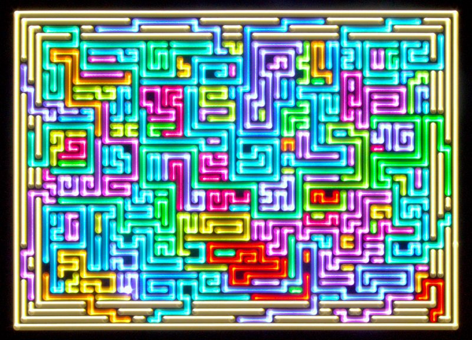
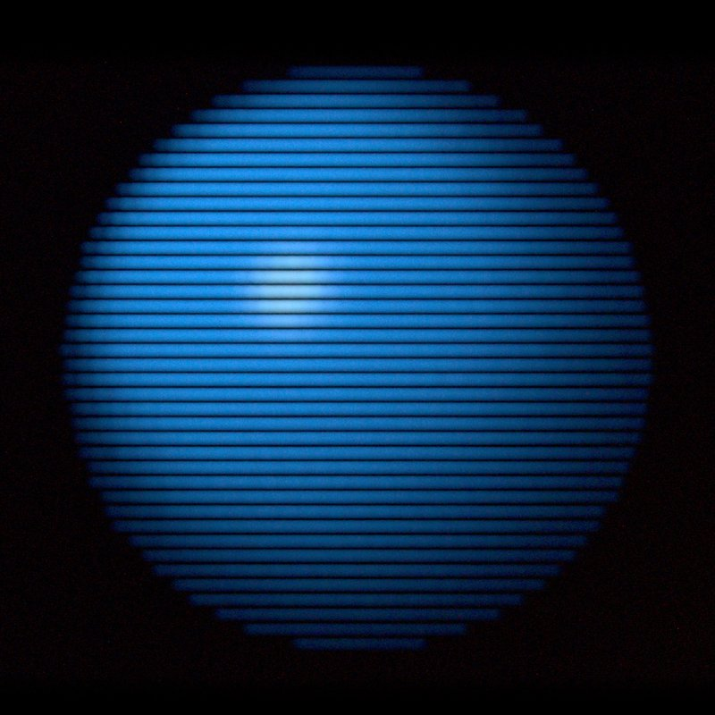
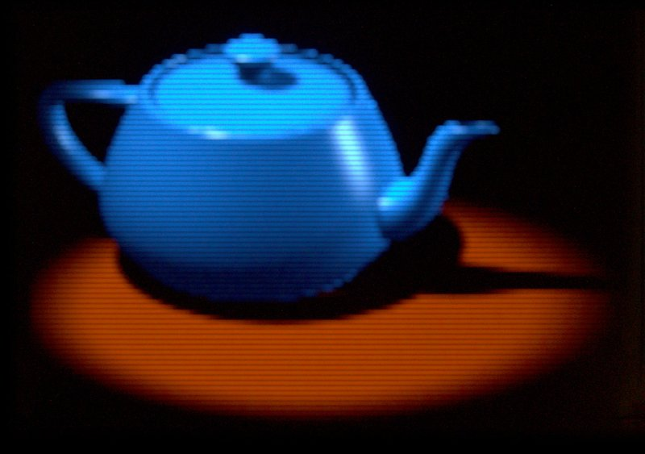
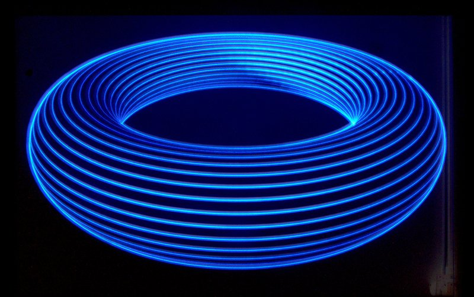
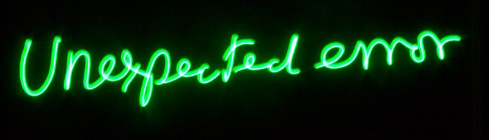
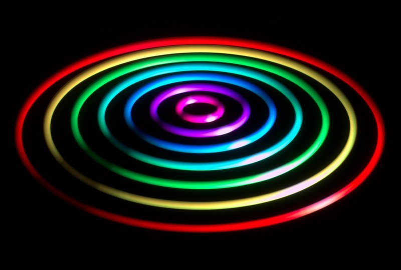
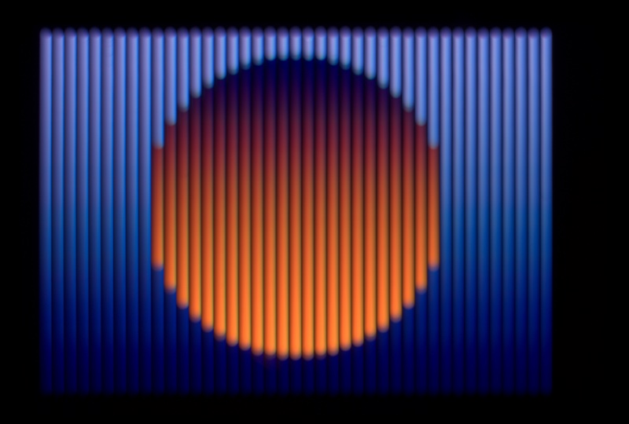
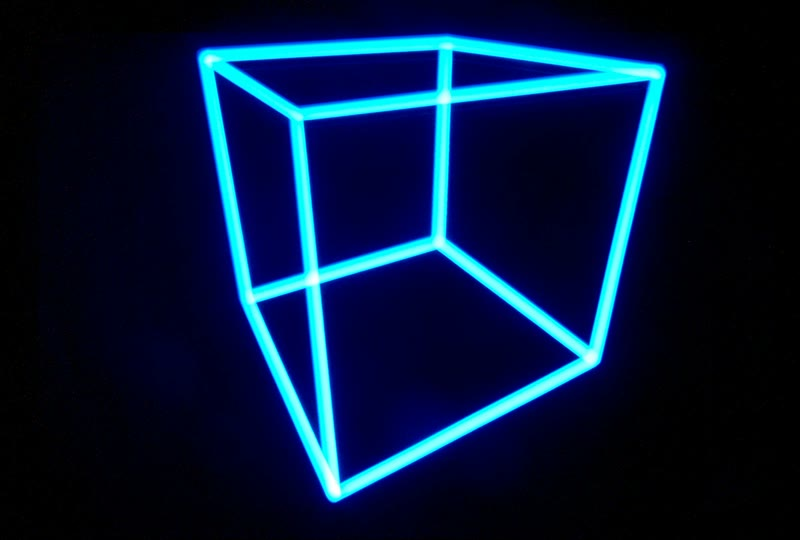

# Gallery

Every picture here is a long exposure. The plotter draws in the dark
with a small colour LED in place of its pen, while a camera above the bed
holds its shutter open. Click any picture for the full-size version.

**_Tektronix_.** The maker's name, traced from a photo of the cover of the user manual.

 

**_No Exit_.** An arena in which snakes spawn and try to find a way out.

 

**_Phong_.** A sphere drawn in horizontal lines, lit by a spotlight with
[Phong shading](https://en.wikipedia.org/wiki/Phong_shading).

 

**_Teapot_.** The [Utah teapot](https://en.wikipedia.org/wiki/Utah_teapot) (Martin Newell, 1975), shaded and drawn in
horizontal lines of light, casting a shadow on an orange spotlit floor.

 

**_Torus_.** A torus drawn as longitudinal lines and a horizon curve, with the
hidden lines removed.

 

**_Unexpected error_.** My poor handwriting.

 

**_Orbits_.** Concentric tubes in perspective.

Each of the apparent tubes in this picture is a single curve. We can
control the position of the highlights along the length of the tube,
but not around its radius. I was surprised that the positions of the
highlights around the radii here look like real shading, but in fact
it's just produced by the fortuitous positioning of the LED
emitters within the diffuse LED housing. It just happens to look
right in this picture.

 

**_Portal_.** I was trying to reproduce the effect of a painting I saw some time ago in a gallery, but failed. Still, I quite like this result.

 

**_Cube_.** An animation of a wireframe cube turning, in strong perspective. Every frame is its own light painting, drawn and
photographed one at a time with the cube turned a little further each time,
then the frames are joined into a video. Click the picture to play it.

[← The Plotting Process](the_plotting_process.md) · [Contents](../README.md) · [Next: The Sketching App →](the_sketching_app.md)
