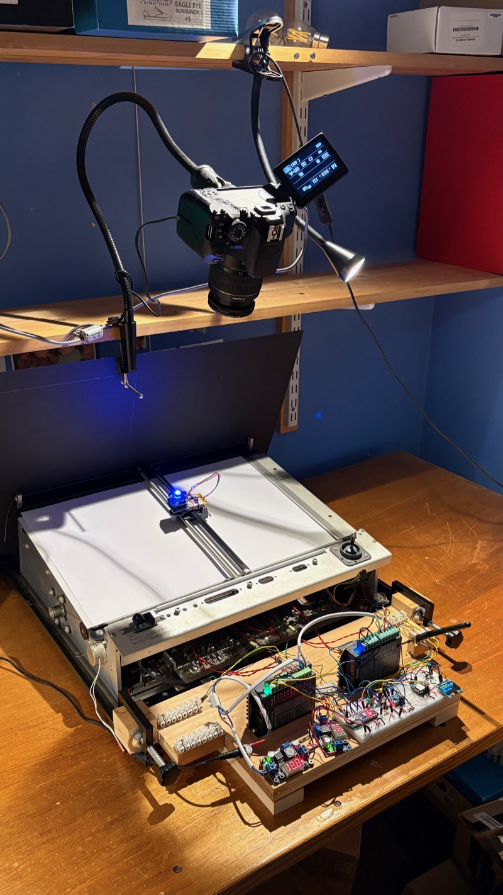
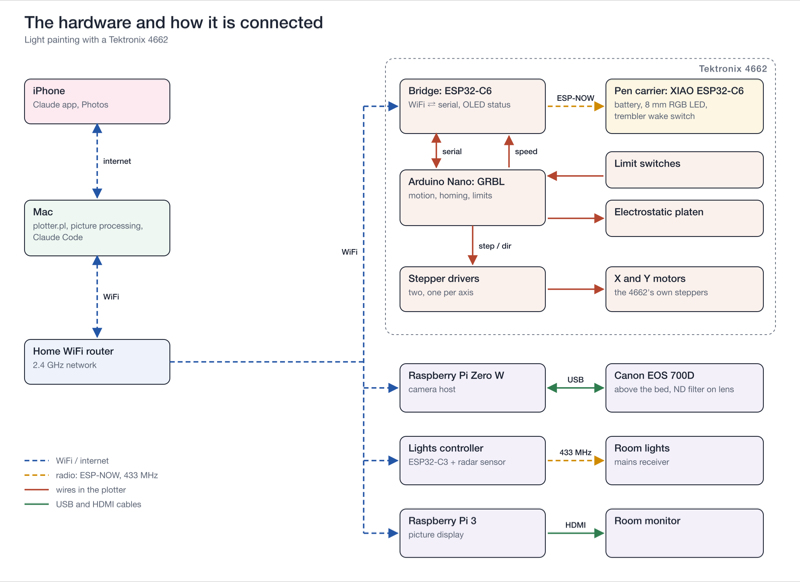

# The Plotter

This project is based on a Tektronix 4662 flatbed plotter. It was made
sometime in the 1970s, as far as I know. I rescued one from being
thrown out, took it home, and left it in the loft for years.

There's a photo of a 4662 in its original form on
[TekWiki](https://w140.com/tekwiki/wiki/4662), where there is more about it.

This is what mine looks like now:

When I finally dusted it off, some of the electronics were dead, but
the electrostatic platen, the stepper motors and the pen lifter
solenoid still worked. (The platen and the pen lifter aren't used in
this project.) I built new electronics and hooked them up as you can
see above. Also in the picture is the camera looking down at the
plotter. I use two, a Canon EOS 700D (the one in the picture) and an older Canon PowerShot A570 IS.

## The Hardware

_The hardware and how it is connected. Click for a version you can zoom._

### The Bridge

This is an [ESP32-C6](https://www.espressif.com/en/products/socs/esp32-c6) with an external WiFi antenna and a small OLED
screen. It receives plot and colour commands from the Mac over WiFi and
passes the G-code on to the [Arduino Nano](https://docs.arduino.cc/hardware/nano/) over a serial line, through a
level shifter (the C6 runs at 3.3 V, the Nano at 5 V). Colours go on to
the pen carrier by radio, using [ESP-NOW](https://www.espressif.com/en/solutions/low-power-solutions/esp-now). The OLED shows the bridge's
address, the last command and [GRBL](https://github.com/gnea/grbl)'s reply, which is handy when
something stops. New firmware goes onto it over WiFi.

It also reads a speed signal from the
Nano and sends it to the carrier with each colour, so the LED can dim
when the pen slows down.

### GRBL on the Nano

GRBL is free firmware for CNC machines, laser cutters and plotters. On
an Arduino Nano it turns G-code into step pulses for the motors,
planning the acceleration through every corner. I changed it to home
just two axes (X, then Y) to the bottom-right corner, where the limit
switches are, and raised its PWM frequency for the pen lifter solenoid.

GRBL's laser mode does something useful here. A laser cutter has to
turn its power down when the head slows, or it burns the corners, so
GRBL scales its PWM output by the head's real speed. The bridge reads
that output as the speed signal.

### The Pen Carrier

The pen is replaced by a [XIAO ESP32-C6](https://wiki.seeedstudio.com/xiao_esp32c6_getting_started/) on a small battery, with a
colour LED pointing up at the camera. I swap between an 8 mm APA-106, which draws soft, fat lines, and a small SK6812, which draws thin, crisp ones and also has a white element. The carrier has no WiFi connection. Colours arrive from the bridge by ESP-NOW, and it
multiplies each one by the speed signal before lighting the LED.

To save the battery it goes into deep sleep five minutes after its
last colour. A trembler switch wakes it, so before a plot the plotter
shakes the carriage for a moment. A freshly charged battery keeps the
LED lit for about five and a half hours.

### The Stepper Drivers

Two TB6600 stepper drivers, one per axis, drive the 4662's original motors
from a 30 V supply at 1 A, in eighth steps. Flat out the pen moves at about 40 cm a second, though light paintings are drawn far slower.

They ran in quarter steps until November, when photos showed a fine
wobble on lines that run nearly along one axis, one wave per step of the slower motor. Halving the step size smoothed it out.

[Contents](../README.md) · [Next: The Plotting Process →](the_plotting_process.md)
