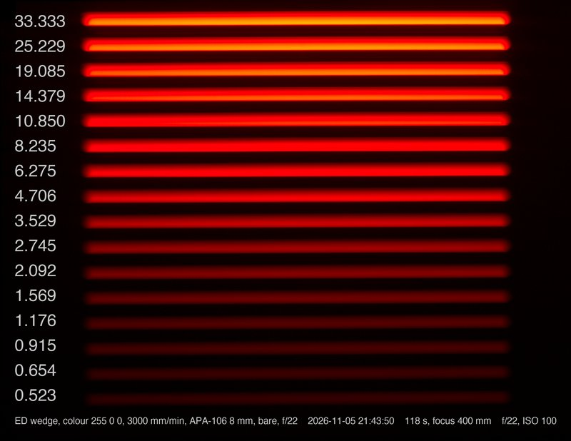
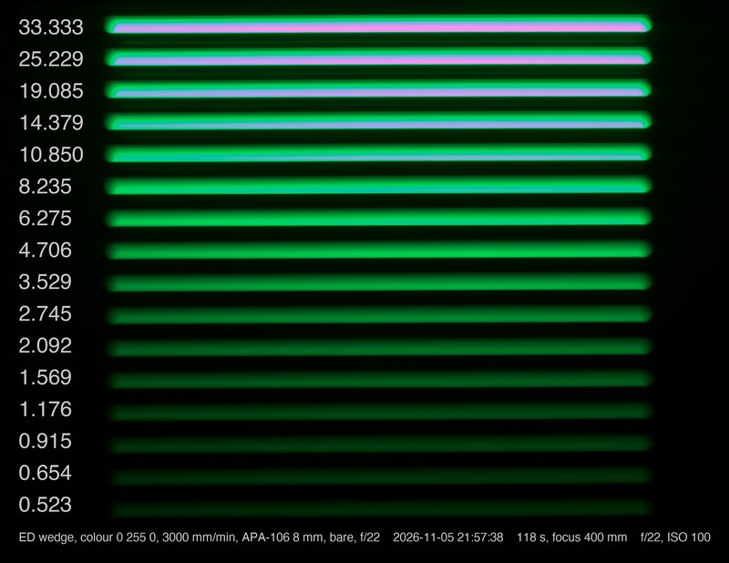
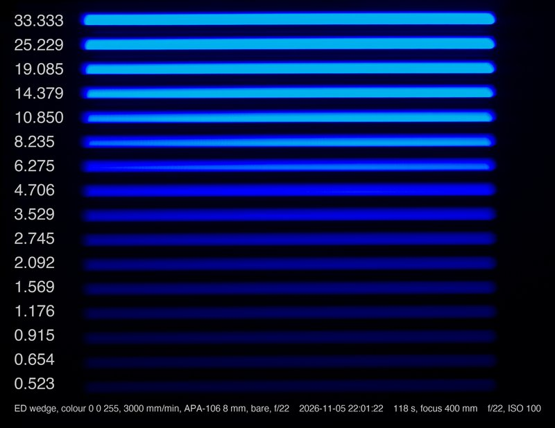
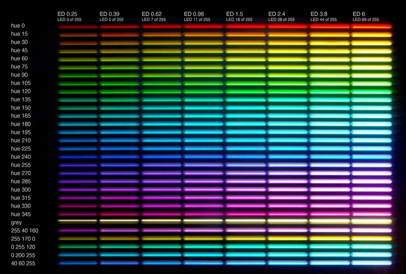
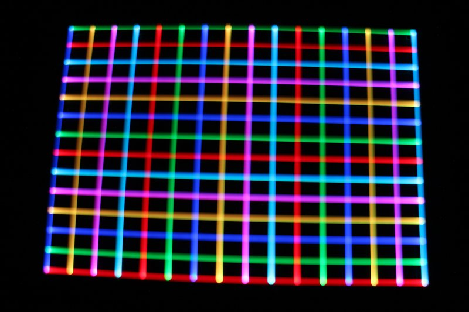
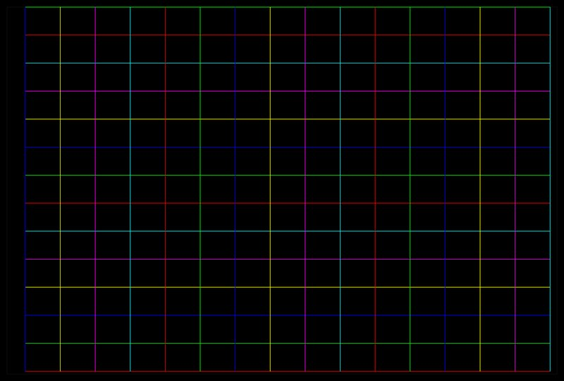
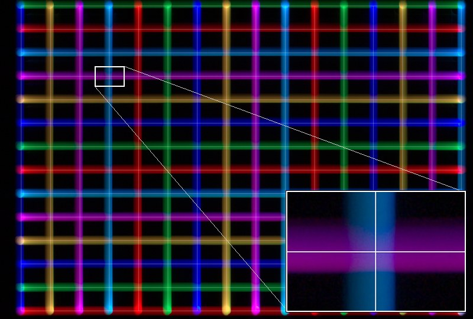

# The Plotting Process

A Perl script reads a plot file and sends the instructions it
contains to the plotter. These files contain plain text like
`moveto` and `drawto` to move the pen, `colour R G B` for the LED and
`speed` for how fast it moves. Most of the plot files used here are
made by Python programs written by Claude. Others are drawn or traced
on the iPad in [PlotterDraw](the_sketching_app.md).

## The steps

This is how we make a picture:

1. Home the plotter and check it is where it should be, then wake the
   LED carrier.
2. Switch the room lights off.
3. Open the shutter and draw the plot (the lit frame).
4. Take an equal exposure with the plotter parked (the dark frame).
5. Draw the calibration grid and photograph it.
6. Subtract the dark frame, straighten the picture, and open the
   result. 
7. Switch the room lights back on.

While I'm developing the process for a particular picture, I just make the
lit frame, but when it starts to look right, Claude can run the whole
process using the `paint` command, to get the final look. The A570 has
a very noisy sensor, caused by heating from its amplifier. The EOS
700D has a much quieter sensor.

## Energy density

The brightness of a line in a plot depends on its exposure, which is a function of the LED brightness and the speed with which it draws. Slow lines are brighter, fast lines dimmer. This is **energy density** (ED), the amount of light energy per mm. I can determine the ED I need by looking at wedge images. 
Each one is one colour drawn at a range of energy densities.

<table>
<tr>
<td></td>
<td></td>
<td></td>
</tr>
<tr>
<td><b>Red</b> (255 0 0)</td>
<td><b>Green</b> (0 255 0)</td>
<td><b>Blue</b> (0 0 255)</td>
</tr>
</table>

## Colour

**Hue map.** How each colour comes out on camera. Rows step round the colour wheel, then grey and a few mixtures, and columns run from faint to strong. Each line is drawn in both directions, so any lag in the LED
shows as a shift between the pair. The labels are added afterwards, not drawn in light.

## Removing distortion

The camera looks down on the bed from an angle, through a lens that bends
straight lines. To turn a photo into an exact plan of the bed, the plotter
draws a grid in which every line has its own colour, so the software can tell
the lines apart in the photo and work out where each part of the picture
really lies.

<table>
<tr>
<td></td>
<td></td>
<td></td>
</tr>
<tr>
<td><b>As photographed.</b> Tilted and bowed by the camera's angle and lens.</td>
<td><b>Where the lines should be.</b> The grid as drawn, in millimetres.</td>
<td><b>Corrected.</b> The photo straightened, with the reference lines drawn on top in white. The inset shows one crossing enlarged, with the white lines running down the middle of the undistorted plotted lines.</td>
</tr>
</table>

## Lettering

Plot files can contain extra drawing instructions (starting with `#@`)
which are ignored by the plotter, but which Claude uses to add titles
and lettering to the plotted images. The numbers on the wedges and
the labels on the hue map are done this way.

[← The Plotter](the_plotter.md) · [Contents](../README.md) · [Next: Gallery →](gallery.md)
