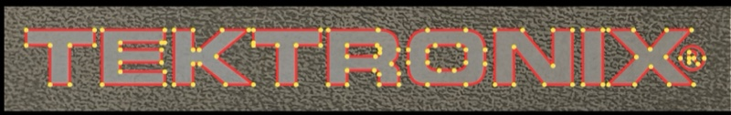

# The Sketching App

I needed a way to create geometry in a form that could be drawn on the
plotter. I used Claude to create an iPad drawing app, PlotterDraw,
that outputs coloured lines and curves as SVG files. I made a
number of pictures this way, but found that I have no talent for
this. We then modified it to enable me to record handwriting as
smoothed curves, as in the handwriting example in the gallery. I then
needed to be able to trace over photos of, for example, the Tektronix
logo. The app provides geometry construction tools that make this
quite easy.

_The tracing (red, with its corner points in yellow) over the photo it
was traced from._

[← Gallery](gallery.md) · [Contents](../README.md) · [Next: Working With Claude →](working_with_claude.md)
