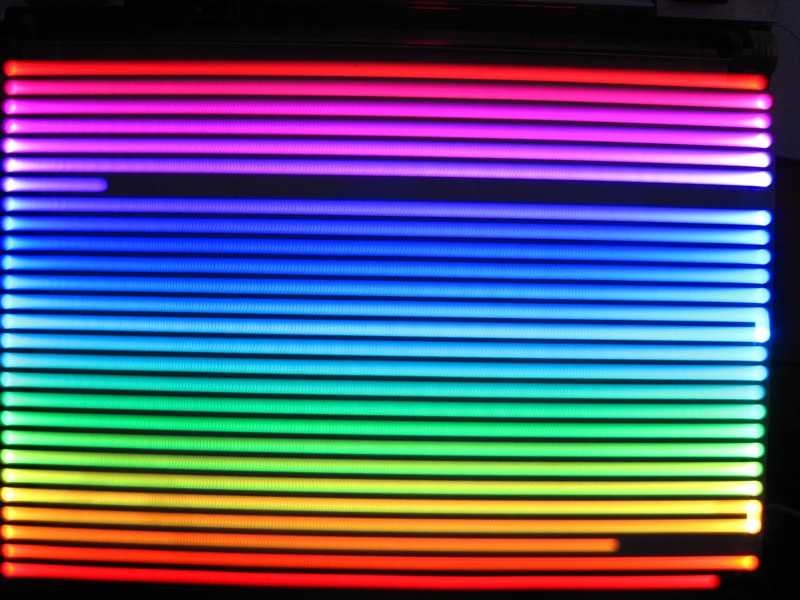

# Working With Claude

This project has been in progress for quite a long time, since before
there were LLMs. Initially, I wrote some driver code on an Arduino
Nano and drove one of the motors through a simple low-voltage motor
controller. Then ChatGPT came along and sped things up, but when I
came across [Claude Code](https://claude.com/claude-code), progress really took off.

I was a software developer for 30 years, and when I retired I became
interested in microcontrollers, and worked on a few entertaining
projects. When I started using LLMs I soon found that my coding skills
(such as they are) had become obsolete. I went through a number of
stages of handing over responsibility to Claude. I didn't intend to
hand over all of the coding, but in the end that's what happened. This
was disappointing to start with, because coding is fun, and I miss the
satisfaction of designing, writing and testing something and getting
it working. So now I design the thing I want, and leave the coding to
Claude. This provides a different pleasure: that of creating things in
far less time than I could on my own.

## Creating the pictures

I'm a frustrated artist. I can imagine pictures I'd like to make, but
I can't paint or draw to save my life. The two things that let me make
pleasing pictures are engineering drawing and computer graphics. Now I
have a plotter (computer graphics again) that can make images by light
painting, but how to program it? The pictures I've made are mostly
procedural (made by code rather than drawn), and in the past I'd have
written the code to make them, but this is an area in which Claude excels.
I describe the pictures I want to Claude, and it writes the programs
that make them. Not that I didn't try drawing: I had a clear idea of
how I wanted [*No Exit*](gallery.md) to appear, an arena of snakes
trying to escape. I used Claude to make [an iPad
app](the_sketching_app.md) for this purpose. I started drawing, but it
soon became clear that it was going to take a long time, and really,
there was no merit in just drawing all these snakes, so I asked Claude
to write a program that draws them. (The app later earned its keep
tracing the Tektronix lettering.)

## Iteration and remote control

Most pictures aren't right first time, and the changes are usually
small: the highlights a little tighter, the shading smoother, one
colour weaker. Because every picture is made by a program, a change
like that is a sentence to Claude rather than an evening's work. It
changes a setting or a few lines of the program, runs the plot, and
the picture comes back for me to look at. [*Orbits*](gallery.md) went
through about twenty-five versions like this, most of them about the
highlights: how big they are, how white, and how much of the ring's
colour they leave around them.

The plotting process is controlled by Claude running on my Mac, giving
instructions to a Perl script which talks to the plotter over WiFi. It
also controls the camera by talking to a [Raspberry Pi](https://www.raspberrypi.com/) over WiFi, which
in turn is connected to the camera by USB. When using my Canon A570 IS
we use [CHDK](https://chdk.fandom.com/wiki/CHDK) and [chdkptp](https://app.assembla.com/spaces/chdkptp/wiki), and with my Canon EOS 700D we use [gphoto2](http://www.gphoto.org/).

There are many lights in the room, but Claude can switch them off and
on by talking to the room lights controller over WiFi.

Because it's all done wirelessly, the Mac doesn't have to be in the
room. Each round takes about ten minutes, most of it the exposure, so
it doesn't matter much where I am either. With Claude Code's remote
control I can run the whole loop from my iPhone: ask for the change,
get a line of news as each stage finishes, and look at the picture when
it lands in the Photos album "claude". So I can sit downstairs in front
of the fire and ask Claude to run a number of iterations, looking for
the result I want. When I'm busy elsewhere I can give it a time limit
and let it iterate on its own. The only thing I have to be at home for
is switching the plotter on.

## Claude's blind spots

Claude can go a long way down the wrong road without stopping to
wonder if there's a better way. An example of this is controlling the
LED brightness and discovering energy density. The pen accelerates,
runs at some maximum speed, then decelerates. To get an even exposure, the
brightness has to be modified as a function of speed. We did this initially by having Claude calculate the speed profile along lines. That worked for a while, but started becoming unwieldy with polygonised curves.

At this point I asked Claude to find a simpler method, and it brought up [GRBL](https://github.com/gnea/grbl)'s laser mode. A laser cutter has the same problem: the laser power has to be modified as the head's speed changes, just like the LED. I called the value energy density, and it's LED brightness per unit length of line. This is very simple and
works very well.

## Problems solved

### Late starts and finishes

For months, some lines of light started late. The pen was already
moving before the LED came on, so the start of the line was
missing. We blamed the radio link to the LED, then the bridge's
display, then GRBL, and fixed real bugs in each along the way, but the
late starts stayed.

In the end we fixed it by making test plots and instrumenting the code, which
enabled us to find timing issues. 

We didn't address the late finishes directly. They disappeared as a side effect of fixing the late starts.

**Late starts.** A test plot from August. Some lines are missing part
of their length, and two pairs are joined at the right, where the LED
stayed on while the pen moved to the next line. Colour messages were arriving at the wrong time in both directions.

### Battery life

The pen carrier runs on a small battery that would be flat in a few hours if it were left on, but asleep it draws almost nothing. The hard part is waking it, because a sleeping radio can't hear the bridge, and
waking every so often to listen proved unreliable. For a while the carrier simply shut down whenever it was left idle, and I had to switch it
off and on again.

We fixed this, at Claude's suggestion, with a trembler switch (a tiny
spring in a can) on one of the carrier's wake pins. We could shake the 
pen carrier and the switch would wake the chip.
On the first attempt, 
we found that the switch's contacts closed, but too briefly
for the sleeping chip to notice, so we added a small capacitor
across it, which lengthens the pulses enough to wake the chip.

Before a plot starts, the bridge pings the carrier to see if it's awake
and if not, the plotter shakes it back and forth by a few mm, which wakes it.
Five minutes after the last time it's lit, it goes back to sleep.

## Conclusion

I still miss writing the code myself, but I don't think I'd have
finished this project without Claude. Its speed at writing and
modifying code and at analysing images has saved me months of work. But
there again, without a background in coding, computer graphics and
photography, I probably wouldn't have got us here.

[← The Sketching App](the_sketching_app.md) · [Contents](../README.md)
